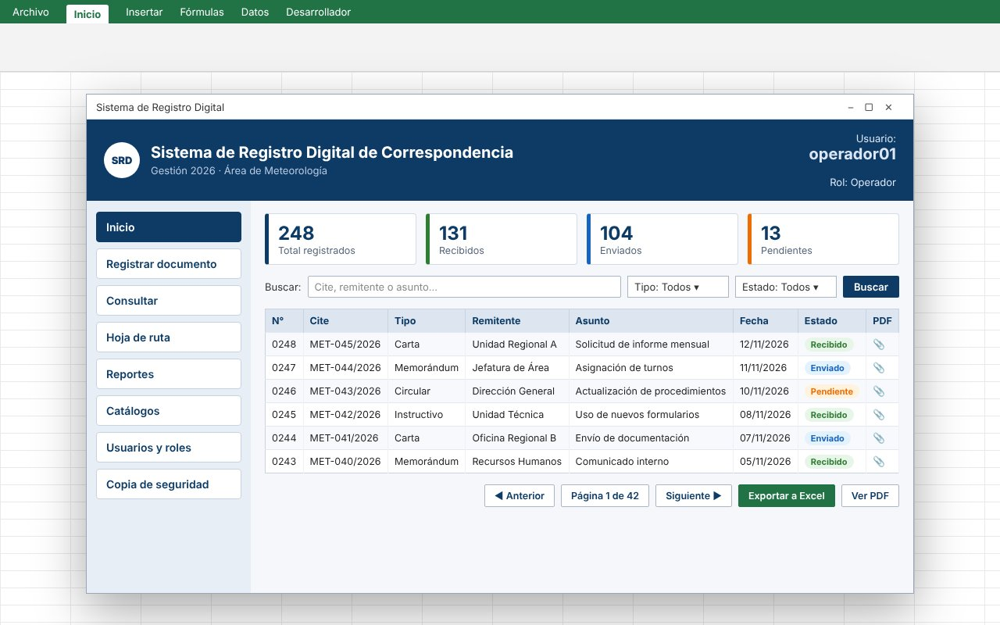

  

<h1 align="center">Sistema de Registro Digital de Correspondencia</h1>

<b>Sistema hecho a medida para el Área de Meteorología de NAABOL</b>

  
  

---

> 🔒 **El código y los datos de este sistema son privados.** La captura es representativa: los nombres y documentos son de ejemplo.

## 📌 Sobre el proyecto

El área necesitaba dejar de registrar su correspondencia a mano. Desarrollé un **sistema dentro de Excel**, con formularios y macros, para **registrar, buscar y dar seguimiento** a cartas, memorándums, circulares e instructivos, con su PDF adjunto.

Se eligió Excel porque el área ya lo usaba todos los días: **no hizo falta instalar nada nuevo ni contratar un servidor**.

## ✨ Funcionalidades

**Registro y consulta**
- Registro de documentos **recibidos y enviados**, con cite, tipo, remitente, destinatario y asunto
- **PDF adjunto** a cada documento, con visor y zoom dentro del sistema
- **Hoja de ruta** para seguir el recorrido de cada documento
- Buscador con filtros por tipo y estado, con paginación
- Panel de inicio con el total de documentos recibidos, enviados y pendientes

**Seguridad y administración**
- **Inicio de sesión con contraseñas cifradas** (hash) y bloqueo por intentos fallidos
- **Roles:** Administrador, Operador y Consulta, cada uno con sus permisos
- Gestión de usuarios y catálogos (tipos de documento, cargos, siglas)
- **Bitácora** de las acciones de cada usuario

**Respaldo y reportes**
- **Copias de seguridad** de los datos y documentos, y opción para restaurarlas
- Reportes y **exportación a Excel**

## 🛠️ Tecnologías

## 📫 Contacto

**Juan José Mamani Machaca**, desarrollador de software y fundador de EMET

- Portafolio: [jose011011.github.io](https://jose011011.github.io)
- EMET: [jose011011.github.io/emet](https://jose011011.github.io/emet/)
- WhatsApp: [+591 64240837](https://wa.me/59164240837)

---
© 2026 Juan José Mamani Machaca. Todos los derechos reservados.
